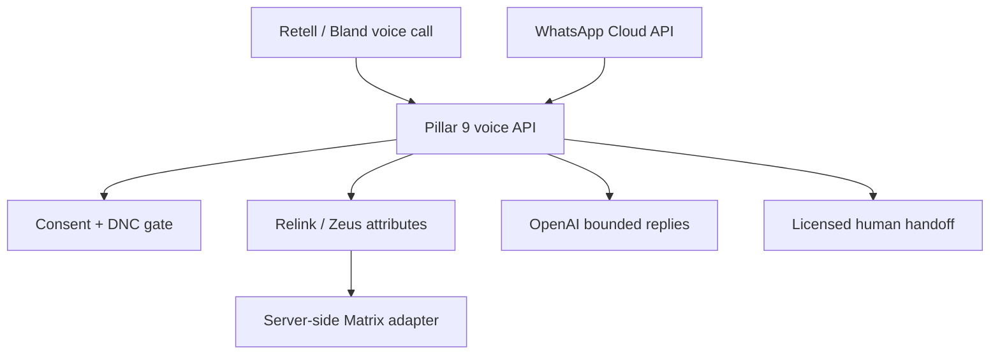

# Pillar 9 Voice Representative

Production-oriented reference implementation for Canadian real-estate voice and WhatsApp workflows. Voice runs on **Retell AI** by default, with the original **Bland AI** path retained behind `VOICE_PROVIDER`; WhatsApp uses Meta Cloud API, with bounded natural-language replies through the OpenAI Responses API. It supports inbound handling and consented outbound buyer, listing-match, showing, seller, relationship, birthday, appointment, and mortgage-coordination workflows.

This is an automated representative, not a licensed REALTOR and not a human impersonator. Every opening identifies automation, Pillar 9, the configured licensed professional, and brokerage. Pillar 9 is treated as the technology service—not the brokerage. That identity rule is enforced in prompts and regression tests and must not be removed.

## What is included

- Zero-dependency Node.js 24 HTTP service and SQLite persistence.
- Retell agent/LLM bootstrap, outbound dispatch, inbound agent binding, and `X-Retell-Signature` webhook verification, plus the retained Bland path: outbound dispatch, inbound number configuration, legacy custom-tool bootstrap, knowledge upload, Pathway-generation preview, test-scenario bootstrap, signed webhooks, and authorized native voice-clone helper.
- Relink/Zeus speech-to-listing-attribute normalization with draft → read-back → explicit-confirmation control.
- A narrow Matrix adapter. The voice model never receives credentials, builds Matrix queries, or receives private remarks.
- A ready SQLite/JSONL Calgary fixture: exactly 5,000 synthetic properties, 119 fields each, all 223 residential communities, all 8,784 named Street Names rows, and all 380 unique current Major Road Network names covered as primary or simulated-nearby language references.
- Meta WhatsApp Cloud API webhook verification, inbound natural replies, option details/comparison, six proactive templates, purpose-specific consent, birthday/date gating, and global STOP handling.
- A responsive one-page internal demo console at `/demo` for a single consented outbound preview/live call, inbound-number configuration, safe runtime status, and recent call activity. It uses a separate limited demo key and cannot purchase numbers or bypass controls.
- Direct server-side OpenAI Responses API integration using `gpt-5.6-luna` by default, `store:false`, a hashed safety identifier, bounded history, and no Matrix credentials or private fields.
- Consent by channel and purpose, internal do-not-contact precedence, contact-local call windows derived from the number’s area/country code, birthday-date gate, just-in-time dispatch, approved message templates, public-link allowlist, idempotent webhooks, and redacted logs.
- Historical market context, neutral listing comparisons, and an educational Canadian mortgage-payment scenario. No valuations, forecasts, offer strategy, negotiations, qualification, or regulated advice.
- 99 authored training/evaluation records: 32 objections, 30 FAQs, 25 criteria examples, and 12 conversation examples, plus 20 adversarial regression scenarios.
- 108 executable tests, including both provider paths, Retell signature/replay and tool-shape tests, the limited demo API, server-clock protection, and local mock OpenAI and Meta API request-shape tests.

## Architecture



Relink/Zeus ends at normalized listing attributes. Only the server-side Matrix adapter translates confirmed criteria into the approved Matrix integration contract.

## Voice providers

`VOICE_PROVIDER=retell` (default) or `VOICE_PROVIDER=bland`. The consent gate, DNC precedence,
calling windows, criteria confirmation, Matrix boundary, and the thirteen tools are shared by both.
See [docs/ANKIT_RETELL_SETUP.md](docs/ANKIT_RETELL_SETUP.md) for the Retell-specific contract,
including the `X-Retell-Signature` scheme and the agent/dynamic-variable model.

## Quick start (safe dry run)

```bash
cp .env.example .env
node scripts/seed.js
node scripts/build-calgary-fixture.js
node scripts/build-knowledge-base.js
node scripts/build-whatsapp-templates.js
node --test --test-reporter=spec
node scripts/smoke-demo.js
node scripts/bootstrap-retell.js
node src/server.js
```

Defaults are development fixtures with `RETELL_DRY_RUN=true` and `BLAND_DRY_RUN=true`; no live call is placed. Test the public health endpoint at `GET /health`, then open `http://127.0.0.1:8787/demo` and enter `DEMO_PANEL_API_KEY`.

## Core API

Administrator routes require `Authorization: Bearer $ADMIN_API_KEY`. Provider tools require `x-p9-tool-key: $TOOL_API_KEY`.

| Route | Purpose |
|---|---|
| `POST /admin/calls/outbound` | Run the just-in-time permission gate and dispatch/dry-run a call |
| `POST /admin/inbound/configure` | Bind the agent to the assigned inbound number |
| `POST /admin/inbound/purchase` | Explicitly confirmed, opt-in billable number purchase (Bland only) |
| `POST /admin/whatsapp/send` | Send/dry-run an approved, consented WhatsApp template |
| `POST /admin/contacts` | Upsert minimum CRM contact data |
| `POST /admin/consents` | Record channel- and purpose-specific consent evidence |
| `POST /webhooks/retell` | Receive `X-Retell-Signature`-verified, idempotent call events |
| `POST /webhooks/bland` | Receive signed, idempotent call results (legacy provider) |
| `GET/POST /webhooks/whatsapp` | Meta verification challenge and signed inbound events |
| `POST /tools/*` | Thirteen narrowly scoped provider custom tools |

Example dry-run call:

```bash
curl -sS https://your-api.example.ca/admin/calls/outbound \
  -H "Authorization: Bearer $ADMIN_API_KEY" \
  -H "Content-Type: application/json" \
  -d '{
    "contactId":"contact_demo_buyer",
    "mode":"buyer_followup",
    "reason":"to follow up on the home search you requested"
  }'
```

Never schedule a call far in advance. The CRM scheduler must invoke this endpoint at the intended time, so consent, DNC, local calling window, representation, and birthday checks run immediately before dialing. Production rejects a deferred `startTime`.

## Production prerequisites

The repository is runnable, but it intentionally cannot manufacture these external dependencies:

1. A Retell (or Bland) account/API key and an assigned Canadian-capable number, plus confirmed outbound country coverage for every destination you intend to dial.
2. A publicly reachable HTTPS deployment. Retell verifies webhooks with `RETELL_API_KEY`; Bland uses `BLAND_WEBHOOK_SECRET`.
3. A verified named licensed professional, licence number, brokerage, transfer destinations, and written scope.
4. A real Pillar 9-approved Matrix adapter endpoint matching [docs/MATRIX_CONTRACT.md](docs/MATRIX_CONTRACT.md).
5. CRM consent evidence, the external compliance/DNCL decision adapter in [docs/COMPLIANCE_GATE_CONTRACT.md](docs/COMPLIANCE_GATE_CONTRACT.md), suppression-list sync, messaging provider, unsubscribe endpoint, and compliance/legal approval.
6. Documented rights to any custom voice. Never clone a person’s voice without explicit authorization.
7. For WhatsApp: Meta Business/WABA assets, approved number and templates, webhook/app secrets, access token, exact-purpose opt-ins, and an OpenAI API project key.

Follow [docs/ANKIT_RETELL_SETUP.md](docs/ANKIT_RETELL_SETUP.md) (or [docs/ANKIT_BLAND_SETUP.md](docs/ANKIT_BLAND_SETUP.md) for the legacy provider), [docs/ANKIT_WHATSAPP_OPENAI_SETUP.md](docs/ANKIT_WHATSAPP_OPENAI_SETUP.md), and then [docs/DEPLOYMENT_CHECKLIST.md](docs/DEPLOYMENT_CHECKLIST.md). The fixture design and exact limitations are in [docs/SYNTHETIC_CALGARY_DATASET.md](docs/SYNTHETIC_CALGARY_DATASET.md).

For a developer starting with no project context, use [docs/ANKIT_COMPLETE_USE_CASE_AND_DEMO.md](docs/ANKIT_COMPLETE_USE_CASE_AND_DEMO.md) first. It explains the Pillar 9/Zeus boundary, every inbound/outbound use case, rules, datasets, Bland API/Pathway/environment/SDK choices, panel operation, demo script and production prerequisites.

The recovered Shane Griffin/August 27 boundary and the separation between this calling agent and the core phone-first Zeus listing microservice are recorded in [docs/PROJECT_CONTEXT.md](docs/PROJECT_CONTEXT.md).

## Official references checked

- [Retell: Create Phone Call](https://docs.retellai.com/api-references/create-phone-call)
- [Retell: Create Agent](https://docs.retellai.com/api-references/create-agent)
- [Retell: Create Retell LLM](https://docs.retellai.com/api-references/create-retell-llm)
- [Retell: Update Phone Number](https://docs.retellai.com/api-references/update-phone-number)
- [Retell: Webhook signature verification](https://docs.retellai.com/features/secure-webhook)
- [Retell: Custom functions](https://docs.retellai.com/build/single-multi-prompt/custom-function)
- [Bland: Send Call](https://docs.bland.ai/api-v1/post/calls)
- [Bland: Purchase an Inbound Number](https://docs.bland.ai/api-v1/post/inbound-purchase)
- [Bland: Update an Inbound Number](https://docs.bland.ai/api-v1/post/inbound-number-update)
- [Bland: Custom Tools](https://docs.bland.ai/api-v1/post/tools)
- [Bland: Knowledge Base text upload](https://docs.bland.ai/api-v1/post/knowledge-learn-text)
- [Bland: Webhook signing](https://docs.bland.ai/tutorials/webhook-signing)
- [Bland: Voices](https://docs.bland.ai/tts/voices)
- [Bland: migrate a TTS client from ElevenLabs](https://docs.bland.ai/tts/migrations/elevenlabs)
- [CRTC telemarketing rules](https://crtc.gc.ca/eng/phone/telemarketing/reg.htm)
- [Canada’s anti-spam legislation guidance](https://www.fightspam.gc.ca/eic/site/030.nsf/eng/00012.html)
- [RECA: regulated real-estate activity](https://www.reca.ca/which-industry/)
- [Meta: WhatsApp Cloud API setup](https://developers.facebook.com/documentation/business-messaging/whatsapp/get-started)
- [Meta: WhatsApp webhooks](https://developers.facebook.com/documentation/business-messaging/whatsapp/webhooks/overview)
- [OpenAI: Responses API quickstart](https://developers.openai.com/api/docs/quickstart)
- [OpenAI: current model guidance](https://developers.openai.com/api/docs/guides/latest-model)
- [Open Calgary: Street Names](https://data.calgary.ca/Base-Maps/Street-Names/hjbp-5p9j)
- [Open Calgary: Community District Boundaries](https://data.calgary.ca/Base-Maps/Community-District-Boundaries/surr-xmvs)
- [Open Calgary: Major Road Network](https://data.calgary.ca/Transportation-Transit/Major-Road-Network/tqjs-vnhy)

Documentation and endpoint shapes were checked on 2026-08-30. Recheck provider documentation before rollout because APIs and rules change.
