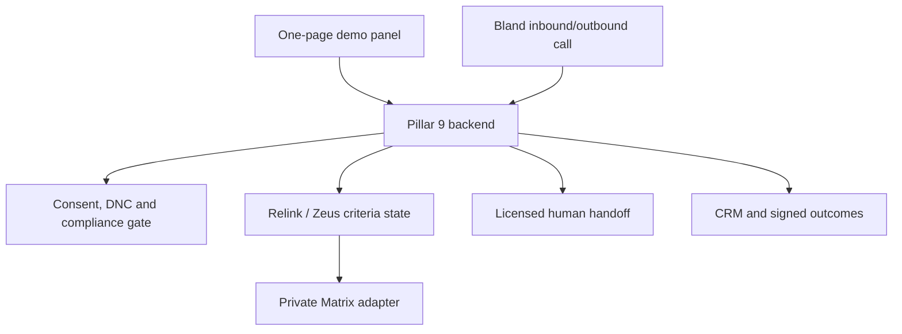

# Pillar 9 Voice Agent — complete use case, rules, implementation and demo guide

**Audience:** Ankit and any developer seeing this project for the first time  
**Status:** working development reference; safe dry-run by default  
**Platform name:** **Bland AI** (not “Blend AI”)  
**Project names:** Pillar 9, Relink, Zeus, Matrix and OneRLS

## 1. Read this first

This package demonstrates a Canadian real-estate communications agent that can:

- receive calls on a Bland Canadian phone number;
- place individually authorized outbound calls;
- understand a buyer’s property requirements through Relink/Zeus;
- read the extracted requirements back and obtain confirmation;
- retrieve factual matching options through a server-side Matrix adapter;
- answer bounded factual questions;
- arrange a showing or licensed callback;
- send approved, separately consented follow-up messages; and
- record signed call outcomes in the Pillar 9 service database.

The agent is a **Pillar 9 automated representative working on behalf of a named licensed real-estate professional at a named brokerage**. Pillar 9 is the technology service; it must not be described as the brokerage. The agent must not claim to be human, a REALTOR®, broker, appraiser, mortgage professional, lawyer, inspector or the customer’s friend.

The voice may be warm, natural and expressive, but natural speech is not permission to hide automation. The opening identifies automation, Pillar 9, the licensed professional, the brokerage and the exact reason for the call.

This package is not connected to live Matrix data, a live Bland account, a real brokerage identity or a real compliance/DNCL provider. The included Calgary properties are synthetic development data.

## 2. How this relates to Shane Griffin’s Pillar 9 requirement

There are two related tracks. They share components but must not be confused.

### Track A — Shane’s primary Relink/Zeus microservice

The August 27 direction was phone-first listing creation and maintenance inside Pillar 9:

1. Phone microphone/camera captures the realtor’s words and selected property evidence.
2. Zeus extracts structured listing attributes.
3. Every extracted value carries evidence and confidence.
4. Missing or conflicting material facts create an **Ask-Next** question.
5. The realtor can accept, edit, reject or defer each value.
6. Zeus may create/update a listing **draft** through a private Pillar 9-approved adapter.
7. Zeus never silently overwrites a value and never auto-publishes a listing.

The production Matrix/OneRLS write contract remains unconfirmed. Field identifiers, enums, units, permissions, version rules, licensing and training rights require written approval.

### Track B — this customer communications demo

This voice agent handles buyer, seller and relationship communications. It reuses the safe Zeus pattern for buyer criteria:

`speech → normalized criteria draft → missing/conflict check → complete read-back → explicit yes → Matrix search`

It does **not** give Bland direct Matrix credentials. Bland calls narrowly scoped Pillar 9 tools. Only the server-side Matrix adapter constructs approved requests and returns allowlisted fields.

## 3. Demo goal

The demo should prove five things in one short session:

1. An operator can enter a Canadian number and select an approved purpose.
2. The backend blocks the call unless exact-purpose voice consent is confirmed.
3. Bland receives a disclosure-first inbound or outbound configuration.
4. A buyer can state requirements naturally, confirm the structured interpretation and receive synthetic matches.
5. The conversation ends with one useful action: a showing request, licensed callback, approved follow-up or respectful closure.

The demo is not intended to prove legal approval, production Matrix access, cold-calling capability, autonomous negotiation, valuation accuracy or mortgage advice.

## 4. People and systems

| Actor/system | Responsibility |
|---|---|
| Customer | Calls the inbound number or receives an expressly authorized outbound call |
| Demo operator | Enters the test number and attests to exact-purpose consent |
| Ava | Configurable automated voice representative name |
| Licensed professional | Owns regulated real-estate advice, representation, offers, negotiation and transaction decisions |
| Brokerage | The licensed professional’s verified brokerage; not Pillar 9 unless legally confirmed otherwise |
| Pillar 9 backend | Identity, consent, DNC, tools, CRM state, audit events and provider orchestration |
| Bland AI | PSTN telephony, speech, Pathway/task execution, transfers and call events |
| Relink/Zeus | Speech-to-structured-attribute normalization, missing/conflict handling and confirmation state |
| Matrix/OneRLS adapter | Server-only translation between confirmed criteria/drafts and approved Pillar 9 data contracts |
| Compliance provider | External consent/DNCL/calling-rule decision immediately before dialing |
| OpenAI | Bounded natural WhatsApp replies only in the current package; not the owner of call permissions or Matrix queries |
| Meta WhatsApp | Optional messaging channel with approved templates and separate consent |

## 5. Architecture



Secrets remain on the server. The browser uses only `DEMO_PANEL_API_KEY`, which is limited to four demo routes. It never receives the Bland, Matrix, OpenAI, WhatsApp, administrator or tool keys.

## 6. Bland implementation modes

### Mode 1 — Call API with a dynamic task prompt

**Use for:** the fastest controlled demo.

The Pillar 9 backend sends `POST /v1/calls` with the number, approved first sentence, voice, task, tools, voicemail, transfer destinations, metadata and signed webhook URL. This mode is implemented now and is selected when `BLAND_PATHWAY_ID` is empty.

Advantages:

- fastest setup;
- every call can carry CRM variables through `request_data`;
- easy to inspect the exact payload in dry-run mode.

Limitations:

- less deterministic than a reviewed Pathway;
- complex branching lives mostly in instructions and tools.

### Mode 2 — Bland Conversational Pathway

**Use for:** staging and production pilots.

Set `BLAND_PATHWAY_ID` and `BLAND_PATHWAY_VERSION`. The backend then sends the same permissioned call but attaches the reviewed Pathway instead of a free-form task.

Recommended Pathway sections:

1. disclosure and permission to continue;
2. mode-specific reason;
3. context lookup;
4. needs discovery;
5. Zeus criteria draft/read-back/confirmation;
6. listing search/details/comparison;
7. showing/callback/follow-up;
8. recap and disposition.

Global interrupts must be reachable from every node:

- STOP/do-not-call/wrong number;
- “Are you automated?”;
- human request;
- recording refusal;
- represented by another professional;
- valuation, offer, negotiation, contract, mortgage, legal or tax question;
- discriminatory neighbourhood request;
- distress, complaint or safety concern;
- missing/conflicting data; and
- tool failure or uncertainty.

When Pathways are used, transfer nodes must be configured and tested in the Pathway itself. Do not assume a task-mode `transfer_list` alone controls every Pathway transfer.

### Mode 3 — Bland v2 Agent environments

If the Bland organization has v2 Agents enabled, maintain separate **development, staging and production** environments:

- **Development:** synthetic contacts, synthetic Calgary database, no live dialing.
- **Staging:** internal opted-in phone numbers, staging Pathway, approved test voice and sandbox Matrix contract.
- **Production:** promoted immutable version, real compliance adapter, real Matrix adapter, approved numbers, verified identity and monitored rollback.

Environment secrets include tool authentication, public API base URL and non-public integration settings. Promote a reviewed version; do not edit production prompts ad hoc.

### Mode 4 — Bland Web Agent SDK

The Web Agent SDK embeds voice interaction in a browser. It is useful if Pillar 9 later wants a “Talk to Ava” button on a website. It does **not** replace the telephone Call API or inbound Canadian number.

The secure SDK pattern is:

`browser → Pillar 9 server creates single-use session token → browser connects to Bland`

Never put the Bland API key in frontend JavaScript. The included one-page panel is a call-control console, not a browser voice-agent implementation.

### Recommended choice

- Two-day demo: **Call API/task mode**.
- Controlled pilot: **Pathway in staging**.
- Production: **versioned Pathway/v2 Agent environment**, if available to the Bland account.
- Optional website voice: **Web Agent SDK** as a separate channel.

## 7. Outbound call use cases

Every outbound mode has a fixed purpose and consent purpose. The operator cannot type a different selling reason.

| Mode | When it is allowed | Exact purpose | Goal | Forbidden behaviour |
|---|---|---|---|---|
| Buyer follow-up | Buyer asked for continued help and valid `voice/buyer_followup` consent exists | Follow up on the requested home search | Refresh criteria and agree on one next step | Cold pitch, pressure, guessing preferences |
| Property-match alert | Buyer requested alerts and valid `voice/property_match` consent exists | Share an update on requested property alerts | Present verified matches and offer links/showing/callback | Inventing availability or model-generated URLs |
| Showing follow-up | Customer attended a showing and valid `voice/showing_followup` consent exists | Follow up on the recent showing | Collect factual feedback and route licensed questions | Arguing, diagnosing defects, negotiation advice |
| Seller follow-up | Seller requested a consultation and valid `voice/seller_followup` consent exists | Follow up on the requested seller consultation | Understand timing and arrange licensed consultation | Estimating value, list price or commission |
| Relationship check-in | Customer requested periodic contact and valid `voice/relationship_checkin` consent exists | Brief requested check-in | Maintain a respectful relationship and offer help | Manufactured urgency or unrelated sales pitch |
| Birthday wish | Local date matches birthday and valid `voice/relationship_message` consent exists | Wish the person a happy birthday | Give a short sincere wish and close | Introducing property or mortgage topics unless customer raises them |
| Mortgage-process coordination | Customer requested coordination and valid `voice/mortgage_process_checkin` consent exists | Coordinate a licensed mortgage callback | Offer a neutral checklist or connect a licensed professional | Rates, products, approval probability, qualification or lender recommendation |

### Mandatory outbound sequence

1. CRM/scheduler requests one approved mode.
2. Backend loads the contact and latest purpose-specific consent.
3. Internal DNC and wrong-number suppression take priority.
4. “Represented by another professional” blocks prospecting outreach.
5. Consent must be granted, current, not future-dated and not expired.
6. Birthday mode checks the contact-local month/day.
7. Contact-local calling window is checked.
8. External compliance/DNCL service returns an allow/deny decision.
9. Backend creates the Bland payload just in time.
10. Bland places the call or returns a dry-run preview.
11. Signed webhook stores outcome and applies any DNC disposition idempotently.

Production rejects caller-supplied evaluation times or deferred dispatch times. It uses the server clock immediately before dialing.

### Outbound opening

> Hi Jordan, this is Ava, an automated Pillar 9 representative calling on behalf of Alex Chen at Example Realty. I’m calling to follow up on the home search you requested. Is now an okay time?

Replace every sample identity before any real call.

## 8. Inbound call use cases

Inbound means the customer calls the assigned Bland number. A dashboard cannot “make an inbound call”; the panel configures the number, after which a tester calls it.

Supported inbound intents:

- new caller asking how the service works;
- existing buyer updating property criteria;
- caller asking for details about a known listing ID;
- buyer comparing two or three verified options;
- request for a showing or licensed callback;
- seller asking for a consultation;
- caller asking to speak with a human;
- mortgage callback coordination;
- existing customer asking for a consented follow-up;
- opt-out, wrong number, complaint or privacy request; and
- after-hours request capture without claiming a human is available.

### Mandatory inbound sequence

1. Bland answers the assigned number.
2. First turn identifies automation, Pillar 9, the licensed professional and brokerage.
3. Ask how to help.
4. Match an existing contact by approved backend logic or collect minimum information.
5. Use history only when identity/context is reliable.
6. Serve the current inbound request.
7. Ask separately before any future call, SMS, email or WhatsApp contact.
8. Transfer or create a callback request for regulated or uncertain matters.
9. Store the signed call outcome and minimal necessary summary.

An inbound call does not automatically create marketing consent.

### Inbound opening

> Thank you for calling Pillar 9. I’m Ava, an automated representative working on behalf of Alex Chen at Example Realty. How may I help?

## 9. Example buyer conversation

This is a behaviour example, not a rigid script.

**Ava:** Hi Jordan, this is Ava, an automated Pillar 9 representative calling on behalf of Alex Chen at Example Realty. I’m following up on the home search you requested. Is now an okay time?

**Customer:** Yes, but I only have a few minutes.

**Ava:** Of course. I’ll keep it brief. Has anything changed in the type of home, area or budget you want?

**Customer:** Detached, northwest Calgary, under $750,000, at least three bedrooms, double garage. A finished basement would be nice.

**Ava:** I captured: detached home in northwest Calgary, maximum $750,000, at least three bedrooms, double garage required, and finished basement preferred. Is that exactly right?

**Customer:** Yes.

**Ava:** Thanks. I’ll check the latest approved listing data using those confirmed filters.

**Tool sequence:** `p9_capture_listing_criteria` draft → explicit yes → confirm → `p9_search_matrix_listings`.

**Ava:** I found three current options in the test data. They are synthetic examples, not homes for sale. Would you like a factual comparison, or should I arrange a callback with Alex?

**Customer:** Compare the first two.

**Tool:** `p9_compare_listings`.

**Ava:** Option one has more living space; option two is lower priced and has the preferred finished basement. This is a factual comparison, not a recommendation. Would you like Alex to discuss either one with you?

**Customer:** Yes, tomorrow afternoon.

**Ava:** I can record tomorrow afternoon as your preferred callback time. Alex’s availability still needs confirmation. Is 2:00 p.m. Mountain Time suitable?

## 10. Conversation rules

### Identity

- Disclose automation in the first sentence of every new call.
- Name Pillar 9, the licensed professional, brokerage and reason.
- If asked, answer directly: “Yes, I’m an automated representative.”
- Never invent human memories, personal experience or physical presence.
- Never imply Pillar 9 is the brokerage unless the verified legal configuration says so.

### Style and naturalness

- Warm, calm, positive and concise.
- One or two short sentences followed by one useful question.
- Allow interruption and stop speaking promptly.
- Use occasional acknowledgements such as “Of course,” “That makes sense,” or “Let me check that.”
- Do not use repetitive fillers, fake laughter, flirting, pet names, overfamiliarity or emotional manipulation.
- Do not create false scarcity, urgency or fear of rising prices.

### Consent and contact rules

- Each channel and purpose has separate consent.
- A buyer-search consent does not authorize a birthday call.
- An inbound inquiry does not authorize future marketing.
- STOP, “remove me,” “do not call,” and wrong-number statements trigger global suppression immediately.
- Do not continue a pitch after opt-out.
- Calls must pass the contact-local time window and external compliance/DNCL decision.
- A person represented by another professional is not solicited.

### Recording

- Recording is off by default.
- Enabling `BLAND_RECORD_CALLS` is not enough: separate current recording consent is still required.
- Unknown inbound callers remain unrecorded unless an approved notice/consent flow is implemented.

### Listing and Matrix data

- Bland never receives Matrix credentials.
- The model never constructs Matrix queries.
- Search only after explicit confirmation of the latest criteria draft.
- Return at most five options and present fewer conversationally.
- Speak only allowlisted public/client fields with source and freshness.
- Never reveal private remarks, showing/access instructions, lockbox codes, occupant data, member-only data or credentials.
- Resolve listing URLs server-side from listing IDs and approved HTTPS hosts.
- If status or source is unavailable, say so and offer a licensed follow-up.

### Regulated and high-impact boundaries

The automated agent must hand off:

- valuation or suggested listing price;
- offer amount, offer strategy or negotiation;
- contract, agency, disclosure or commission interpretation;
- mortgage product, rate, lender, qualification or approval prediction;
- legal, tax, financial or investment advice;
- inspection or property-condition conclusion;
- guaranteed appreciation, price forecast or “buy now” recommendation; and
- complaints, distress or safety concerns.

It may provide sourced historical context with an as-of date and an explicit non-predictive label. It may calculate an educational principal-and-interest scenario with stated assumptions, but not qualification or advice.

### Fair housing and neighbourhood questions

- Never steer based on protected characteristics.
- Do not label an area “safe,” “good for families,” “Christian,” “Indian,” or otherwise infer demographic suitability.
- Offer objective user-selected facts such as commute, property type, price range or public amenity distance when the approved data source supports them.

### Failure behaviour

- Never guess after a tool timeout.
- State what could not be verified.
- Retry only when the workflow allows it.
- Offer a licensed callback or human transfer.
- Store a minimal technical outcome without sensitive prompt data.

## 11. Objection handling

| Customer statement | Required response pattern |
|---|---|
| “I’m busy.” | Acknowledge, offer one specific callback option or end immediately |
| “I’m not interested.” | Thank them, record the disposition and end without another pitch |
| “Are you AI?” | Confirm that it is an automated Pillar 9 representative |
| “I want a human.” | Offer transfer/callback; do not continue discovery first |
| “Stop calling.” | Apply DNC, confirm once and end |
| “Wrong number.” | Apologize, suppress the record, confirm once and end |
| “I already have an agent.” | Respect representation, update the record and end solicitation |
| “Will this property go up?” | Explain that future value cannot be predicted and offer sourced history/licensed discussion |
| “What should I offer?” | Route to the licensed professional |
| “Can I qualify for this mortgage?” | Route to a licensed mortgage professional |
| “Send me the listing.” | Check separate message-channel consent and resolve the approved link server-side |

## 12. Pillar 9 tools available to Bland

| Tool | Purpose |
|---|---|
| `p9_check_outbound_permission` | Mandatory just-in-time call gate |
| `p9_get_contact_context` | Minimum masked CRM context |
| `p9_capture_listing_criteria` | Zeus normalize → draft → read-back → confirm |
| `p9_search_matrix_listings` | Search using latest confirmed criteria only |
| `p9_get_listing_details` | Retrieve approved fields for one active listing |
| `p9_compare_listings` | Factual comparison of two or three options |
| `p9_get_historical_market_context` | Sourced, dated, non-predictive history |
| `p9_calculate_educational_payment` | Labelled educational payment scenario |
| `p9_request_professional_appointment` | Showing, real-estate or mortgage callback request |
| `p9_send_approved_followup` | Consent-gated approved SMS/email template |
| `p9_update_relationship_note` | Minimal customer-confirmed CRM note |
| `p9_apply_do_not_call` | Immediate suppression and consent revocation |
| `p9_escalate_to_human` | Licensed, privacy, complaint, distress or technical handoff |

Tools are authenticated with `TOOL_API_KEY`, stored in Bland’s secure server-side configuration. Never put this key in call text, request variables, training data or the demo panel.

## 13. Dataset requirements

The agent does not need a single giant “training file.” It needs several governed datasets with different jobs.

### A. Identity and operating configuration

Required fields:

- licensed professional name and internal ID;
- licence number and jurisdiction;
- brokerage legal/display name;
- licensed transfer number;
- mortgage-professional transfer number;
- transfer hours and fallback;
- assistant display name;
- approved inbound/outbound numbers; and
- voice identifier plus proof of voice rights.

Sample values in `.env.example` are placeholders and must be replaced.

### B. Contact, consent and suppression dataset

For each contact:

- stable CRM contact ID;
- E.164 phone number;
- minimum necessary name;
- timezone;
- birthday only if required and lawfully collected;
- represented-by-other indicator;
- relationship note only when customer-confirmed;
- consent channel;
- exact consent purpose;
- granted/revoked status;
- capture source and timestamp;
- expiry, if applicable;
- evidence reference; and
- DNC/wrong-number/complaint status.

Do not import a lead list and treat it as consent.

### C. Conversation knowledge dataset

Current package:

| File | Records | Use |
|---|---:|---|
| `datasets/faq.json` | 30 | Approved factual answers and boundaries |
| `datasets/objections.json` | 32 | Objection-response patterns |
| `datasets/criteria-examples.json` | 25 | Speech-to-criteria normalization examples |
| `datasets/conversation-examples.json` | 12 | Inbound/outbound style and workflow examples |
| `datasets/regression-scenarios.json` | 20 | Adversarial release tests |

The build script renders 74 FAQ/objection/conversation records into Bland’s text knowledge base. Criteria examples are tested by code because extraction must be deterministic and independently evaluated.

### D. Property development dataset

Current fixture:

- exactly 5,000 synthetic Calgary properties;
- 119 required fields per property;
- 8,784 named City street references covered;
- 380 current major-road names covered;
- 223 residential communities covered;
- all four Calgary quadrants;
- property-level split: 3,996 train, 493 development, 511 locked holdout.

All property facts, prices, coordinates, proximity and availability are fictional. Real City names are public naming taxonomy. This schema is not the confirmed Matrix schema.

### E. Production Matrix dataset/contract

Required before connection:

- exact resource and field IDs;
- types, enums, units and null rules;
- create/update draft permissions;
- public vs member/private visibility;
- listing status semantics;
- timestamps and source labels;
- version/ETag or optimistic concurrency contract;
- idempotency keys;
- pagination/rate limits;
- sandbox records;
- audit/retention rules; and
- written confirmation of evaluation, storage and model-training rights.

Do not fine-tune on Matrix exports merely because they are available to the application.

### F. Evaluation dataset

Maintain a locked set not used to revise prompts. It must test:

- accents, noise, interruptions, silence and voicemail;
- every call mode;
- consent missing/expired/future-dated;
- DNC, wrong number and representation;
- criteria ambiguity and conflict;
- private-data extraction attacks;
- invented links/status/price;
- valuation, forecast, negotiation and mortgage requests;
- fair-housing steering attempts;
- tool timeout and malformed response;
- transfer failure; and
- webhook replay or bad signature.

### G. Real-call improvement data

After written approval, use redacted and access-controlled call outcomes to improve tests—not automatically as model training. Review:

- containment vs appropriate handoff;
- criteria precision/recall;
- confirmation accuracy;
- opt-out detection;
- unsupported-claim rate;
- transfer success;
- latency/interruption quality;
- customer complaints; and
- mode-specific outcome.

## 14. One-page demo panel

The working panel is served by this repository at:

`GET /demo`

It provides:

- separate limited demo-key login;
- environment and dry-run/live badge;
- first name, Canadian number, timezone, purpose and birthday inputs;
- operator consent attestation;
- additional live billable-call confirmation;
- dry-run evaluation time for controlled testing only;
- outbound preview/live dispatch;
- assigned inbound number display and copy button;
- inbound Bland configuration button;
- safe runtime summary; and
- recent live dispatch/webhook activity.

The panel deliberately excludes:

- Bland number purchase;
- bulk upload/batch dialing;
- free-text call reasons;
- arbitrary prompt editing;
- Matrix credentials/private fields;
- administrator operations;
- raw recordings/transcripts; and
- a switch that bypasses consent, DNC or calling windows.

### Demo API routes

These routes accept `x-p9-demo-key: DEMO_PANEL_API_KEY`:

- `GET /demo-api/status`
- `POST /demo-api/outbound`
- `POST /demo-api/inbound/configure`
- `GET /demo-api/interactions?limit=12`

The demo key cannot access `/admin/*` or `/tools/*`.

## 15. Local setup for Ankit

### Prerequisites

- Node.js 24 or later;
- the project ZIP;
- no Bland key is required for dry run;
- a modern browser; and
- an internal test number only when moving to controlled live testing.

### Start the safe demo

```bash
cp .env.example .env
node scripts/build-calgary-fixture.js
node scripts/build-knowledge-base.js
node scripts/build-whatsapp-templates.js
node --test --test-reporter=spec
node src/server.js
```

Keep these values:

```dotenv
NODE_ENV=development
BLAND_DRY_RUN=true
DEMO_PANEL_ENABLED=true
DEMO_PANEL_API_KEY=use-a-separate-random-demo-key
DEMO_PANEL_ALLOW_LIVE_CALLS=false
MATRIX_MODE=fixture
```

Open:

`http://127.0.0.1:8787/demo`

Enter `DEMO_PANEL_API_KEY`, fill the contact form, confirm exact-purpose consent and click **Preview outbound call**. The result shows the complete Bland payload without sending a call.

### Use the 5,000-property database as the runtime database

Create a working copy of `fixtures/calgary-synthetic-5000.sqlite` under `data/` and point `DATABASE_PATH` to that copy. Do not run mutable demo contacts against the immutable packaged fixture if the fixture must remain byte-identical.

## 16. Bland account setup

1. Create the Bland organization and restrict account access.
2. Add billing limits and alerts.
3. Select a curated voice for the first demo, such as a Bland voice preset.
4. If using a custom voice, obtain written speaker/owner authorization before cloning or migration.
5. Obtain/assign a Canadian-capable number in the Bland portal.
6. Deploy this backend to a public HTTPS URL.
7. Configure `PUBLIC_BASE_URL` and a strong `BLAND_WEBHOOK_SECRET`.
8. Build the knowledge file: `node scripts/build-knowledge-base.js`.
9. Run `node scripts/bootstrap-bland.js` with dry run still enabled and inspect `generated/bland-bootstrap-preview.json`.
10. In a controlled setup environment, create the 13 tools and knowledge resource, then store returned IDs in `BLAND_TOOL_IDS` and `BLAND_KNOWLEDGE_BASE_IDS`.
11. Build/review a Pathway and set `BLAND_PATHWAY_ID` for staging.
12. Configure the inbound number.
13. Run Bland Agent Testing scenarios before any external contact.

For the first demo, use an approved Bland voice rather than adding ElevenLabs as another live dependency. If a licensed ElevenLabs voice must be retained, follow Bland’s current migration guidance and confirm rights; do not connect a personal voice or expose an ElevenLabs key in the panel.

## 17. Controlled live-demo switch

Only after all prerequisites are ready:

```dotenv
BLAND_API_KEY=server-side-key
BLAND_DRY_RUN=false
BLAND_FROM_NUMBER=+1XXXXXXXXXX
BLAND_INBOUND_NUMBER=+1XXXXXXXXXX
BLAND_TOOL_IDS=approved-tool-ids
BLAND_KNOWLEDGE_BASE_IDS=approved-knowledge-ids
DEMO_PANEL_ALLOW_LIVE_CALLS=true
```

Live mode still requires:

- operator consent checkbox;
- second live-call confirmation;
- DNC clearance;
- representation clearance;
- exact-purpose active consent;
- contact-local calling window;
- external compliance decision;
- fixed approved call reason; and
- provider credentials.

Use only internal staff or specifically opted-in test participants. Do not set `NODE_ENV=production` until the real Matrix, compliance and messaging adapters are connected; production configuration rejects fixture adapters.

## 18. Demo script

### Demo 1 — outbound buyer follow-up

1. Show `DRY RUN` badge.
2. Enter an internal Canadian test number.
3. Select **Consented buyer follow-up**.
4. Leave consent unchecked and click; show the block.
5. Check consent and preview again.
6. Point out disclosure, fixed reason, tools, recording off and webhook.
7. In a controlled staging account, repeat with the opted-in tester and complete the buyer conversation.

### Demo 2 — property criteria and matches

Tester says:

> I need a detached home in northwest Calgary under $750,000, three bedrooms, double garage, and a finished basement would be nice.

Expected:

1. draft saved;
2. complete read-back;
3. explicit yes;
4. search;
5. up to five results, with three spoken;
6. synthetic-data notice;
7. factual comparison or licensed callback.

### Demo 3 — inbound

1. Enter the demo key.
2. Confirm the assigned number is displayed.
3. Click **Configure inbound** in dry run and inspect the prompt.
4. In staging, apply the live configuration.
5. Call the assigned number from an internal test phone.
6. Ask for a human, then test STOP on a separate synthetic contact.

## 19. Acceptance criteria

The demo passes only when:

- panel works on desktop and mobile width;
- no provider secret appears in HTML/API output;
- missing demo key is rejected;
- missing operator consent is rejected;
- live calls are impossible while `DEMO_PANEL_ALLOW_LIVE_CALLS=false`;
- opening discloses automation and full identity;
- calling-window and DNC blocks prevent Bland dispatch;
- criteria cannot be searched before read-back confirmation;
- private Matrix fields never appear;
- synthetic properties are labelled on every presentation;
- licensed/high-impact questions hand off;
- recording is off without separate consent;
- invalid webhook signature is rejected;
- duplicate webhook is ignored; and
- STOP creates global suppression.

Current automated baseline after adding the panel: **80 tests passed, 0 failed**.

Before a limited external pilot, run at least 50 internal, expressly consented calls across modes, accents, quiet/noisy audio, interruption, voicemail, silence, tool latency and failure cases.

## 20. Production prerequisites and owners

| Requirement | Suggested owner | Status in package |
|---|---|---|
| Bland account, billing and Canadian number | Pillar 9 operations | Not supplied |
| Verified licensed professional and brokerage | Business/legal owner | Placeholders only |
| Voice rights | Business/legal owner | Not supplied |
| Exact consent evidence and DNC import | CRM/compliance owner | Fixture only |
| External Canadian compliance/DNCL API | Compliance owner | Fixture adapter only |
| Public HTTPS deployment and secrets | DevOps | Not supplied |
| Bland tools/knowledge/Pathway IDs | Ankit | Dry-run generator included |
| Matrix/OneRLS schema and rights | Pillar 9 domain owner | Unconfirmed |
| Matrix sandbox and HTTP adapter | Pillar 9 backend team | Contract stub included |
| Transfer numbers and hours | Licensed business owner | Placeholders only |
| SMS/email provider and unsubscribe | Messaging owner | Log adapter only |
| Legal/privacy/retention review | Pillar 9 counsel/privacy | Required |
| Supervised acceptance and rollback | Product/QA | Test plan included |

## 21. What Ankit should not do

- Do not remove automation disclosure to make the voice appear human.
- Do not call Pillar 9 a brokerage without verified legal configuration.
- Do not paste Matrix, Bland, OpenAI, WhatsApp or ElevenLabs keys into prompts/frontend code.
- Do not enable number purchase from the demo page.
- Do not upload a cold lead list and auto-grant consent.
- Do not allow free-text outbound reasons.
- Do not send raw Matrix queries or private fields to a model.
- Do not let a model generate listing URLs.
- Do not describe historical data as a forecast.
- Do not let the agent negotiate, value a property or qualify a mortgage.
- Do not use fixture results as if they were current listings.
- Do not auto-publish a Zeus-created listing draft.
- Do not use real Matrix/call data for model training without written rights.

## 22. File map

| Path | Purpose |
|---|---|
| `src/demo-panel.js` | Complete responsive one-page panel |
| `src/http.js` | Panel, limited demo API, admin API, tools and webhooks |
| `src/services.js` | permissions, call payloads, demo orchestration and inbound config |
| `src/prompts.js` | identity, style, safety and mode instructions |
| `src/tool-manifest.js` | 13 Bland tool definitions |
| `src/criteria.js` | Relink/Zeus criteria normalization |
| `src/adapters.js` | Bland, Matrix, compliance, messaging, OpenAI and WhatsApp adapters |
| `src/db.js` | contacts, consent, DNC, criteria, calls and fixture persistence |
| `datasets/` | knowledge, conversations, objections, evaluations and fixture data |
| `fixtures/calgary-synthetic-5000.sqlite` | ready 5,000-property database |
| `docs/ANKIT_BLAND_SETUP.md` | detailed Bland account/bootstrap instructions |
| `docs/ANKIT_WHATSAPP_OPENAI_SETUP.md` | Meta WhatsApp and OpenAI instructions |
| `docs/DEPLOYMENT_CHECKLIST.md` | live-release sign-off |
| `docs/MATRIX_CONTRACT.md` | required private adapter contract |
| `docs/TEST_PLAN.md` | automated and human acceptance |

## 23. Official documentation checked

- [Bland — Send Call](https://docs.bland.ai/api-v1/post/calls)
- [Bland — Update Inbound Number](https://docs.bland.ai/api-v1/post/inbound-number-update)
- [Bland — Conversational Pathways](https://docs.bland.ai/tutorials/pathways)
- [Bland — Custom API integration](https://docs.bland.ai/tutorials/tools/custom-api)
- [Bland — Post-call webhooks](https://docs.bland.ai/tutorials/post-call-webhooks)
- [Bland — Web Agent SDK](https://docs.bland.ai/sdks/web-agent-sdk)
- [Bland — Call Logs](https://docs.bland.ai/tutorials/call-logs)
- [Bland — Agent testing starter flow](https://docs.bland.ai/starter-guide)
- [OpenAI — Responses API quickstart](https://developers.openai.com/api/docs/quickstart)
- [Meta — WhatsApp Cloud API](https://developers.facebook.com/documentation/business-messaging/whatsapp/get-started)

Provider APIs and regulatory requirements change. Recheck current documentation and obtain Canadian legal/compliance approval before live deployment.
